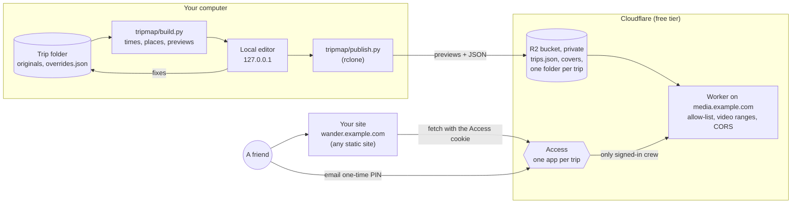

# Wander

A private, map-first archive of your trips. Every photo and video from a trip lands on a map, a day-by-day timeline and a gallery. The originals never leave your disk: only small previews go online, and each trip is visible only to the people who were on it, who sign in with their email. It runs on Cloudflare's free tier (R2, a Worker, Access), with no database and no server to look after.

**Live example:** [wander.job-joseph.com](https://wander.job-joseph.com). The landing page is public; every trip on it is locked, so you'll see covers and a sign-in button, not the photos.

## Why I built it

I'm Job. In 2026 I spent twelve days in Thailand with friends and came home with about a thousand photos and videos: phone photos with GPS, clips from a DJI pocket camera that records no location and keeps its own clock, and a stream of WhatsApp forwards with their metadata stripped. That's 140 GB of originals.

I wanted us to be able to relive the trip the way it happened: where we were, day by day, in order. Shared albums lose the *where*; cloud drives want all 140 GB and show a grid of files; a public site was out of the question. And I didn't want my friends or my parents to have to create an account anywhere.

So Wander does three things:

1. **Works out when and where each shot happened**, from whatever clues it has: EXIF and GPS, the DJI clock (with an offset you set once), filenames, and the nearest geotagged shot in time.
2. **Lets you fix what it got wrong** in a local editor: place shots on the map, move them to another day, shift times, pick the cover, hide shots.
3. **Publishes only previews** (about 2.5 GB per thousand shots) to a private bucket, behind one Cloudflare Access app per trip. Friends get a one-time PIN by email and see only their trips.

The site at wander.job-joseph.com was built with [Lovable](https://lovable.dev) (in [a separate repo](https://github.com/Jcube101/travelogue-map-memory)) on top of two small JSON files. That interface is documented, so you can [build your own site](#build-your-own-site), or start from the [reference viewer](site/).

## How it fits together



- **Originals** stay on your disk. `build.py` reads them (never changes them) and writes `_tripmap/` next to them: thumbnails, 640 px cards, 1600 px photos, 720p videos and the map data.
- **The editor** (`serve.py` + `viewer.html`) runs only on your machine and saves fixes to `overrides.json` in the trip folder.
- **Publish** uploads only what the trip's `trip.json` references, then updates the public `trips.json` list and covers.
- **The Worker** serves an allow-list of files from the private bucket. **Access** decides who sees which trip; the Worker never does.
- **The site** is just a static page that reads `trips.json` and `<slug>/trip.json` from the media host with the visitor's cookie.

## Quick start

The local part needs no account: build a trip, then fix it on a map.

```
git clone https://github.com/Jcube101/wander
cd wander
pip install pillow                     # plus exiftool and ffmpeg, see tripmap/README.md
python tripmap/build.py "<trip folder>" --name "Lisbon 2025" --tz +01:00 --quick
python tripmap/launcher.py "<trip folder>"
```

Then double-click `Open Wander Editor.bat` (Windows) or run `open-wander-editor.sh` (mac/Linux) in the trip folder: the map opens in your browser, in edit mode. `--tz` is the trip's UTC offset; DJI clips need `--camera-offset` too ([tripmap/README.md](tripmap/README.md)).

To put trips online behind sign-in, follow **[SETUP.md](SETUP.md)** once: Cloudflare account and domain, R2 bucket, Worker, Access, then your first published trip.

Windows-tested; mac/Linux should work.

## Build your own site

A Wander site only needs to read two JSON files from your media host:

- `trips.json` (public): every trip's title, dates, counts and cover, for the landing page.
- `<slug>/trip.json` (behind Access): the trip's days and items, each with a time, an optional place, and paths to its thumbnail, card and full preview.

Fetch them with `credentials: 'include'`, show times in the trip's own zone, and send people to `/auth/<slug>` to sign in. The [data contract in SPEC.md](SPEC.md#data-contract--build-your-own-site) has the exact shapes and the few rules that matter.

Or use the **[reference viewer](site/)**: a static site (no build step) with the trip list, a map, day filter, gallery, photo/video viewer and the sign-in flow. Set your media host in one file and deploy it to Cloudflare Pages.

## What's here

| Path | What it is |
|---|---|
| [`tripmap/`](tripmap/) | Builder, local editor, publish, Access scripting and launchers (Python, no dependencies besides Pillow). [README](tripmap/README.md) |
| [`worker/`](worker/) | The Cloudflare Worker for the media host (plain JS, no dependencies). |
| [`site/`](site/) | Reference viewer: a static site for your trips, deployable to Cloudflare Pages. [README](site/README.md) |
| [`wander.config.example.json`](wander.config.example.json) | Template for your instance settings (`~/.wander/config.json`). |

| Doc | For |
|---|---|
| [SETUP.md](SETUP.md) | First-time setup, step by step |
| [RUNBOOK.md](RUNBOOK.md) | Everyday tasks, a new trip, troubleshooting |
| [SPEC.md](SPEC.md) | What each part must do, and the data contract |
| [LEARNINGS.md](LEARNINGS.md) | Gotchas and the decisions behind the design (the real stories) |
| [ROADMAP.md](ROADMAP.md) | Done, now, next |
| [CONTRIBUTING.md](CONTRIBUTING.md) | Dev setup, tests, the rules every change keeps |

## License

[MIT](LICENSE). A personal project, maintained in spare time.
